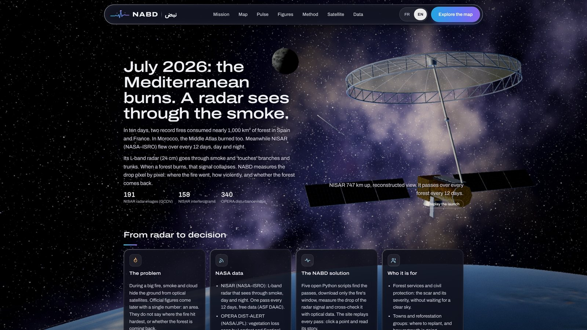
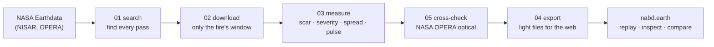
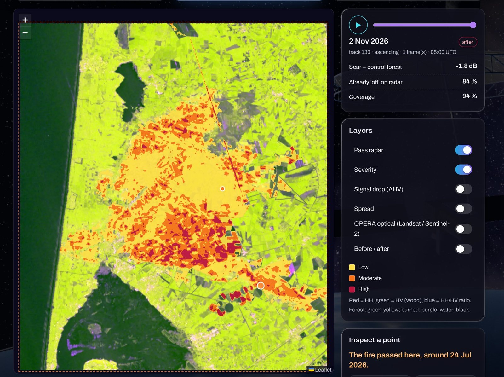
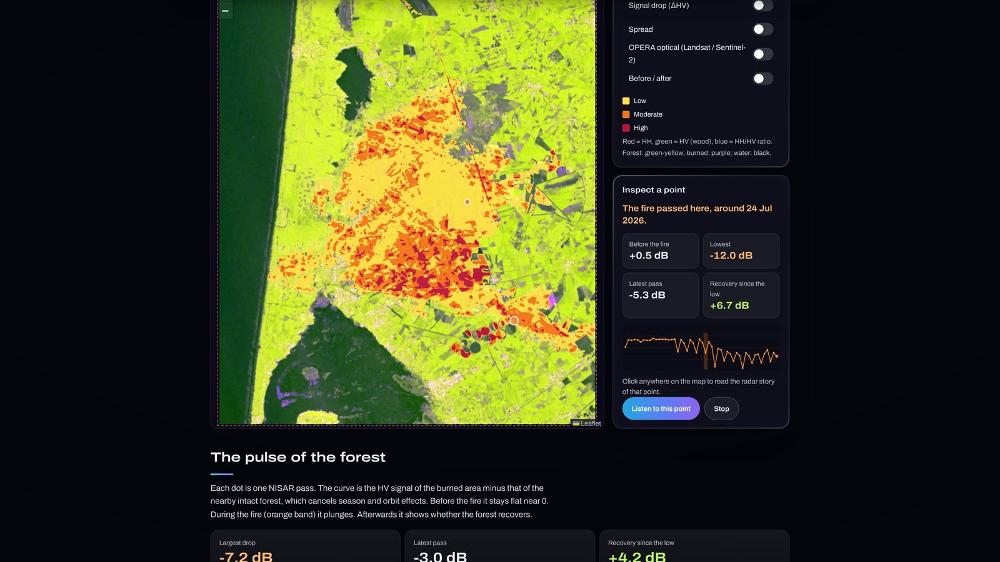
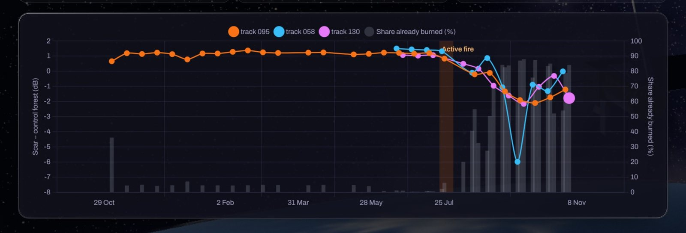
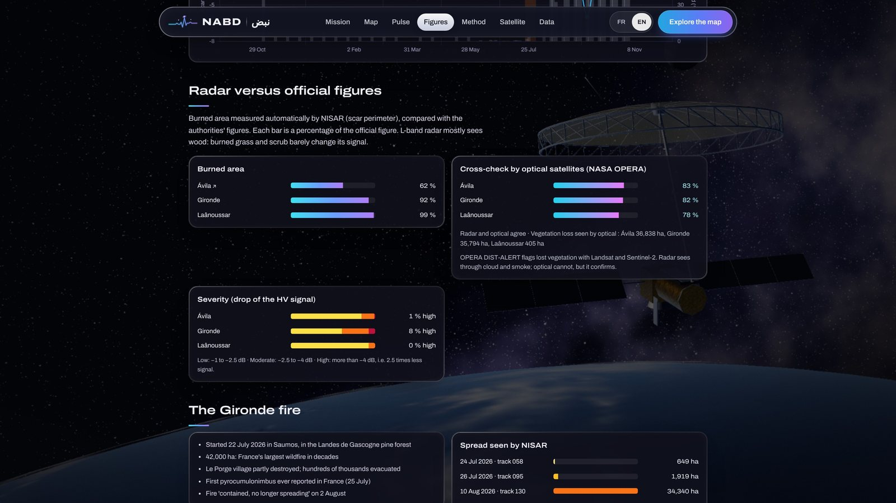
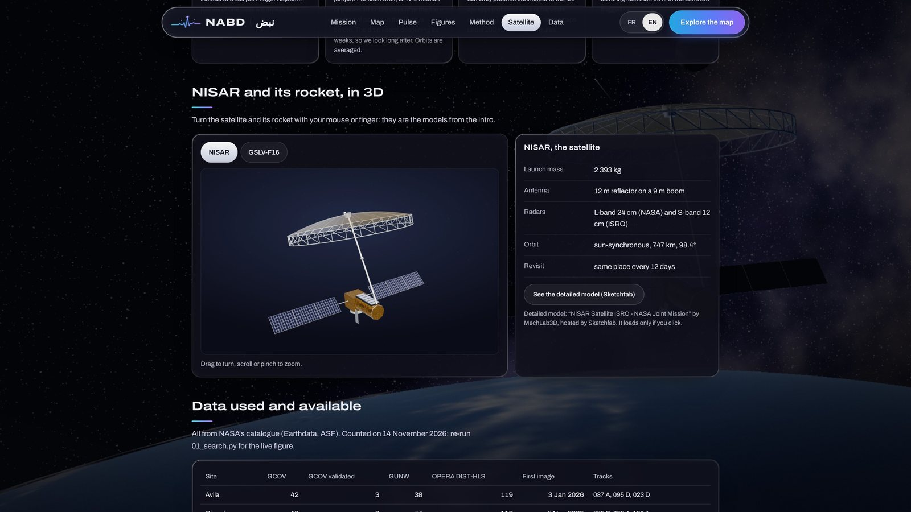

# NABD نبض — the pulse of forests, seen from space

**NABD** measures wildfires with radar. It uses the new **NASA–ISRO NISAR** satellite, whose L‑band radar sees through smoke, cloud and night, to show **where** a fire burned, **how severely**, and **whether the forest is growing back**.

🏆 **1st place, NASA Space Apps Challenge 2026** (event hosted at ENSIASD Taroudant, Morocco) · Challenge: *Dancing with the SARs*

**🌍 Live website: [nabd.earth](https://nabd.earth)** &nbsp;·&nbsp; mirror: [nabd-neon-six.vercel.app](https://nabd-neon-six.vercel.app)

[](docs/nabd-demo.mp4)

▶️ **[Watch the demo video (75 seconds, with voice-over)](docs/nabd-demo.mp4)**

---

## The problem

In July 2026, record wildfires burned close to 1,000 km² of forest in Spain and France, and the Middle Atlas burned in Morocco.

- **During a fire, smoke and cloud hide the ground** from optical satellites (Landsat, Sentinel‑2). The best images often come too late.
- **Official reports give a single number**: a burned area. They do not show where the fire was most severe, or whether the forest recovers in the months that follow.
- **Radar data is free but hard to use**: about 6 GB per scene, and difficult to read for a forest service or a town hall.

## Our solution

An open **Python pipeline** turns raw NISAR radar data into fire maps, and a **website** lets anyone explore them, with no installation needed.



When a forest burns, the L‑band radar (24 cm wavelength), which "touches" branches and trunks, gets a **weaker echo**. NABD measures that drop pixel by pixel, at every satellite pass, and compares it with nearby intact forest.

## Results on real NISAR data

| Fire | Dates | Official area | NISAR (NABD) | Share of official | Confirmed by NASA OPERA | NISAR passes |
|---|---|---|---|---|---|---|
| **Gironde** (France) | 22 Jul → 2 Aug 2026 | 42,000 ha | 38,643 ha | **92 %** | **82 %** | 50 |
| **Laânoussar, Sefrou** (Morocco) | 31 Jul → 7 Aug 2026 | 480 ha | 473 ha | **99 %** | **78 %** | 40 |
| **Ávila, Burgohondo** (Spain) | 22 Jul → 6 Aug 2026 | ≈ 50,000 ha | 30,995 ha | **62 %** | **83 %** | 44 |

- **Share of official**: our radar area divided by the official figure.
- **Confirmed by NASA OPERA**: the share of our radar burn scar where NASA's OPERA DIST‑ALERT product (Landsat 8/9 + Sentinel‑2) also detects vegetation loss. The two measurements are independent (microwaves versus visible and infrared light).
- **Why Ávila is lower**: part of the fire lies outside the analysed frame, and much of what burned was scrub and grassland, which L‑band radar sees poorly. The optical check agrees: within our frame it finds 36,838 ha of vegetation loss, against 26,514 ha for the radar.

## NASA data used

| Data | What we use it for | Where |
|---|---|---|
| **NISAR L2 GCOV** (L‑band, HH and HV, terrain‑corrected) | burn scar, severity, spread, pulse | ASF DAAC, via `earthaccess` and NASA Harmony |
| **OPERA DIST‑ALERT‑HLS** (NASA/JPL, Landsat + Sentinel‑2) | independent optical cross‑check | LP DAAC, via `earthaccess` |
| **Blue Marble** (NASA Earth Observatory) | the Earth in the 3D intro | NASA Visible Earth |

All of it is free and open. A free NASA Earthdata account is enough.

## Who it is for

- **Forest services and civil protection**: the burn scar and its severity without waiting for a clear sky, to decide where to secure and replant first.
- **Towns and reforestation groups**: where to replant, and how regrowth is going, every 12 days.
- **Researchers, students, citizens**: a documented method, open code and open data.

---

## The website

| | |
|---|---|
|  | **Map**: replay every NISAR pass, then switch layers: radar, severity, signal drop, spread, NASA OPERA optical check, before/after slider. |
|  | **Inspect a point**: click anywhere and get a plain sentence ("The fire passed here, around 24 Jul 2026"), with the values before the fire, at the lowest and now, a small chart, and a sound version. |
|  | **The forest's pulse**: the scar's radar signal minus intact forest, at every pass. Flat before the fire, a sharp drop during it, and a rise when the forest regrows. |
|  | **Figures**: radar versus official areas, severity, and agreement with NASA OPERA. |
|  | **NISAR in 3D**: the satellite and its GSLV‑F16 rocket, to turn around in the browser. |

Also:
- A **3D intro** reconstructs the real launch of NISAR (GSLV‑F16, 30 July 2025, Sriharikota), with synced sound and a mission clock.
- The site works in **English and French**, on desktop and phone.
- It stays **fast**:
  - the 3D background pauses while you read;
  - images and per‑point data load only when needed;
  - the 3D viewer starts only on request;
  - it switches to a light mode on modest graphics cards.

---

## Run it yourself

### View the website (no NASA account needed)

The results are already in `web/data/`.

```bash
git clone https://github.com/SONITO-WA/nabd.git
cd nabd
python -m http.server 8000 -d web      # then open http://localhost:8000
```

Do not open `index.html` by double‑clicking. Opened as a plain file, the browser blocks the 3D intro and the data. An internet connection is needed for the base map and the charts.

### Rebuild the data from NASA

```bash
python -m venv .venv
.venv\Scripts\activate                  # macOS/Linux: source .venv/bin/activate
pip install -r requirements.txt
```

Create a free account at <https://urs.earthdata.nasa.gov/users/new>, then a `_netrc` file (Windows, in `C:\Users\YOU\`) or `~/.netrc` (macOS/Linux):

```
machine urs.earthdata.nasa.gov login YOUR_USERNAME password YOUR_PASSWORD
```

**Never commit this file**: it is excluded by `.gitignore`.

```bash
python scripts/01_search.py --zone all         # list NISAR passes over each fire
python scripts/02_download.py --zone all       # download only each fire's window (add --method stream if Harmony fails)
python scripts/03_fire.py --zone all           # burn scar, severity, spread, pulse
python scripts/05_dist.py --zone all           # optional: NASA OPERA optical cross-check
python scripts/04_export.py                    # writes web/data/
```

No account? `python scripts/00_make_demo.py` creates **synthetic** data on the real NISAR dates, so you can test the pipeline. The site then shows a "demo" banner.

### Deploy

- **Vercel**: from the `web` folder, run `vercel --prod`.
- **GitHub Pages**: Settings → Pages → *Deploy from a branch* → `main`, `/ (root)`. The root `index.html` redirects to `web/`.

## Repository layout

```
scripts/
  config.py         fires, dates, thresholds
  common.py         shared tools (GCOV reading, mosaicking, Lee filter)
  00_make_demo.py   synthetic data to test without a NASA account
  01_search.py      find NISAR passes (ASF)
  02_download.py    download only the useful window (Harmony)
  03_fire.py        scar, severity, spread, pulse (GeoTIFF + JSON)
  05_dist.py        cross-check with NASA OPERA DIST-ALERT
  04_export.py      writes web/data/ (data.js + per-point history cube_*.bin + layers)
web/
  index.html        the website (Leaflet map, Chart.js charts)
  intro/            3D launch intro (three.js) and Earth textures
  hangar/           3D view of NISAR and the GSLV
  vendor/           three.js and the Archivo font, vendored
  data/             results shown by the site
docs/               screenshots and the demo video
```

## Method (`03_fire.py`)

SAR **change detection**, rule‑based and fully transparent (no machine learning: NISAR is brand new, so there is no labelled training data yet).

1. **Clean**: neighbouring frames of a pass are mosaicked, then a Lee speckle filter is applied and values are converted to decibels (HH, HV).
2. **Normalise**: each pass is calibrated on the **unburned** part of the scene, which cancels rain and calibration jumps. Passes that jump by more than 3 dB are rejected.
3. **Before / after**: for each orbit, ΔHV = median of passes **10 to 120 days after** the fire minus median of passes in the **75 days before**. Orbits are averaged, then smoothed (45 m). The drop keeps deepening for 2–3 months after a fire, as needles fall and trunks dry, so looking only right after the fire underestimates it.
4. **Classify**: burned = vegetation before (HV > −22 dB) **and** ΔHV < **−1 dB**. Only patches **connected to the fire** are kept: connected‑component analysis from the ignition area, with links up to 1 km. A 200 m morphological closing gives the perimeter, as official maps do.
5. **Severity**: low (−1 to −2.5 dB), moderate (−2.5 to −4 dB), high (below −4 dB).
6. **Spread**: for each burned pixel, the first pass during the fire where it dropped by more than 1.5 dB.
7. **Pulse**: mean HV of the scar minus mean HV of nearby intact forest, at every pass. The difference cancels season and orbit effects.

All thresholds live in `scripts/config.py`. GeoTIFF outputs (`dHV_dB.tif`, `severity.tif`) open in QGIS.

## Limitations

- NISAR products are still **provisional** (calibration in progress).
- Some passes are missing between 27 Jul and 10 Aug 2026, which is why several orbits are combined.
- On steep slopes (Middle Atlas, Gredos), radar shadow and layover can disturb the measurement.
- The −1 dB threshold was tuned on the real 2026 images.
- L‑band sees burned grass and scrub poorly (see Ávila).
- The OPERA "vegetation loss" status codes used by `05_dist.py` (2, 3, 5, 6, 7, 8) give 78–83 % agreement with the radar. They should still be checked against the official product documentation.

## Credits and licences

- **Radar**: NASA/JPL–ISRO NISAR mission, data distributed by the ASF DAAC.
- **OPERA DIST‑ALERT**: NASA/JPL OPERA project, distributed by the LP DAAC.
- **Earth textures**: derived from NASA *Blue Marble* imagery (NASA Earth Observatory).
- **Base map**: Esri World Imagery.
- **Libraries**: [three.js](https://threejs.org) (MIT), [Leaflet](https://leafletjs.com) (BSD‑2), [Chart.js](https://www.chartjs.org) (MIT), [earthaccess](https://github.com/nsidc/earthaccess) (MIT). Font [Archivo](https://github.com/Omnibus-Type/Archivo) (SIL Open Font License, see `web/vendor/fonts/`).
- **3D models**: NISAR and the GSLV‑F16 of the intro are hand‑built for NABD from the configuration published by ISRO. The detailed NISAR model shown on request is « [NISAR Satellite ISRO - NASA Joint Mission](https://sketchfab.com/3d-models/nisar-satellite-isro-nasa-joint-mission-0103309668d243dbbfab3c8fc6b9683c) » by MechLab3D, **embedded from Sketchfab** and not copied into this repository.
- **Official fire figures**: see the source list at the bottom of the website.
